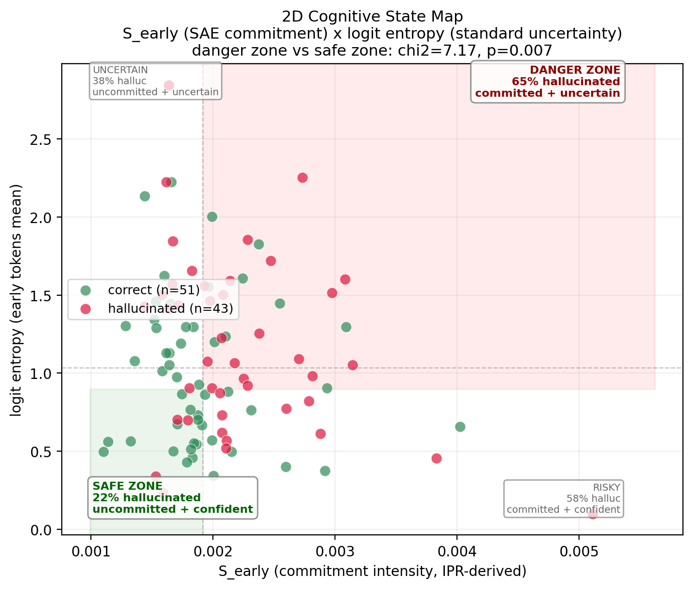

```
  ███████╗ █████╗ ████████╗██╗  ██╗ ██████╗ ███╗   ███╗
  ██╔════╝██╔══██╗╚══██╔══╝██║  ██║██╔═══██╗████╗ ████║
  █████╗  ███████║   ██║   ███████║██║   ██║██╔████╔██║
  ██╔══╝  ██╔══██║   ██║   ██╔══██║██║   ██║██║╚██╔╝██║
  ██║     ██║  ██║   ██║   ██║  ██║╚██████╔╝██║ ╚═╝ ██║
  ╚═╝     ╚═╝  ╚═╝   ╚═╝   ╚═╝  ╚═╝ ╚═════╝ ╚═╝     ╚═╝
```

### cognitive state measurement for transformers

> SAE feature decomposition reveals a cognitive property — **commitment intensity** — that is
> statistically significant, beats standard uncertainty baselines, and is completely invisible
> to three independent raw-activation probes across four transformer architectures.
>
> **SAEs are not interpretability aids. They are the spectroscopes of artificial cognition.**

<p align="center">
  
</p>

<p align="center">
  <a href="https://doi.org/10.5281/zenodo.19437539"></a>
  <a href="https://fathom-gpu.darkcity.wtf/demo"></a>
  <a href="https://fathom-gpu.darkcity.wtf/docs"></a>
  <a href="https://osf.io/wtkzg"></a>
  <a href="https://fathom.darkflobi.com"></a>
</p>

---

## results at a glance

```
 cross-architecture     d = 0.584      Fisher p = 0.00018
 beats logit entropy    AUC 0.663      vs 0.607 (p = 0.013)
 2D cognitive map       65% halluc     danger zone vs 22% safe
 SAE necessity          3 probes       4 architectures — all null
 architectures          Gemma-2-2B     Llama-3.2-1B confirmed
 patents                3 filed        US 64/020,489 · 64/021,113 · 64/026,964
```

---

## what is commitment intensity?

```
                    ┌─────────────────────────────────────────┐
                    │          S = max(C∆) / K_τ              │
                    │                                         │
                    │   C∆(t) = coherence_late - coherence_early   │
                    │   K_τ   = count of spikes above threshold    │
                    │                                         │
                    │   mathematically equivalent to:         │
                    │   S = M × IPR(event_locations)          │
                    │                                         │
                    │   IPR = inverse participation ratio     │
                    │   (condensed-matter physics, 70+ years) │
                    └─────────────────────────────────────────┘

     high S ──► few intense commitment events ──► attractor lock-in
     low  S ──► many distributed events      ──► exploration
```

---

## cross-architecture replication

```
  MODEL                    LAYERS    WINDOW     d        AUC      p
  ─────────────────────────────────────────────────────────────────
  Gemma-2-2B-IT              26     [0, 7)    +0.535    0.663    0.013
  Llama-3.2-1B-Instruct      16     [0, 20)   +0.635    0.641    0.005
  ─────────────────────────────────────────────────────────────────
  POOLED                                      +0.584             0.00018
```

commitment window scales with model depth. fewer layers → more tokens to settle.

## head-to-head vs standard methods

```
  SIGNAL                AUC      p          SOURCE
  ──────────────────────────────────────────────────
  S_early (ours)       0.663    0.013  ◄── SAE coherence
  logit entropy        0.607    0.053      standard
  logprob              0.559    0.291      standard
  top-2 margin         0.477    0.624      standard
  ──────────────────────────────────────────────────
  S is the ONLY feature reaching significance.
  r(S, entropy) = -0.17 — nearly independent signals.
```

## SAE necessity — the probes that failed

```
  PROBE                  ARCHITECTURES    FISHER p    RESULT
  ─────────────────────────────────────────────────────────
  top-k IPR                    4           0.619      null
  cross-layer cosine           4           0.948      null
  cognitive fingerprint        4             —        AUC 0.566
  ─────────────────────────────────────────────────────────
  SAE-based S (Gemma)          1           0.013      ✓ confirmed
  SAE-based S (Llama)          1           0.005      ✓ confirmed
  ─────────────────────────────────────────────────────────
  SAE decomposition is doing irreplaceable work.
```

---

## quick start

```python
from coherence_steerer_ext import CoherenceSteererExt

steerer = CoherenceSteererExt(model_name="google/gemma-2-2b-it")
result = steerer.generate_with_entropy(
    "Q: What is the capital of France?\nA:",
    max_tokens=20
)

# per-token commitment + entropy
for i, (cd, ent) in enumerate(zip(
    result.c_delta_trajectory,
    result.entropy_trajectory
)):
    print(f"  t={i}: C_delta={cd:+.4f}  entropy={ent:.3f}")
```

## API

```bash
curl -X POST https://fathom-gpu.darkcity.wtf/scan \
  -H "Content-Type: application/json" \
  -d '{"prompt": "What did Paul Revere say?", "max_tokens": 20}'
```

returns per-token `c_delta`, `entropy`, `logprob` + cognitive zone classification:

```
  SAFE       low commitment + low entropy      grounded retrieval
  UNCERTAIN  low commitment + high entropy     exploring
  RISKY      high commitment + low entropy     confident — verify
  DANGER     high commitment + high entropy    hallucination signature
```

---

## repository structure

```
  fathom-research/
  │
  ├── README.md                  you are here
  ├── coherence_steerer.py       core SAE measurement engine
  ├── depth_scorer.py            depth scoring via circuit attribution
  ├── requirements.txt           dependencies
  │
  ├── paper/                     ICML 2026 workshop submission (LaTeX)
  ├── analysis/                  28 analysis scripts
  ├── runners/                   experiment drivers
  ├── probes/                    SAE-free cross-architecture probes
  ├── verification/              reproducibility (17 + 14 assertions)
  ├── viz/                       figure generators
  ├── api/                       Fathom Scan API v2 + interactive demo
  │
  ├── findings/                  documented results
  ├── prereg/                    OSF pre-registrations (locked before data)
  ├── docs/                      strategy, vision, applications
  │
  ├── figures/                   publication figures (PDF + PNG)
  └── truthfulqa_results/        experimental data (JSON)
```

## reproducibility

```bash
python verification/verify_all_claims.py   # 17 assertions from raw data
python verification/verify_s_axis.py       # 14 S-axis specific assertions
```

all claims in the paper verified to reproduce exactly from saved JSON data.

---

## citation

```bibtex
@article{rodabaugh2026fathom,
  title   = {Commitment Intensity: A Physics-Grounded Cognitive
             Measurement from SAE Feature Coherence Trajectories},
  author  = {Rodabaugh, Alexander},
  year    = {2026},
  note    = {Zenodo. doi:10.5281/zenodo.19437539}
}
```

## license

research code — patent pending (US 64/020,489 · 64/021,113 · 64/026,964)

---

<p align="center">
  <strong>Fathom Intelligence</strong> · <a href="https://fathom.darkflobi.com">fathom.darkflobi.com</a> · Alexander Rodabaugh · 2026
</p>
